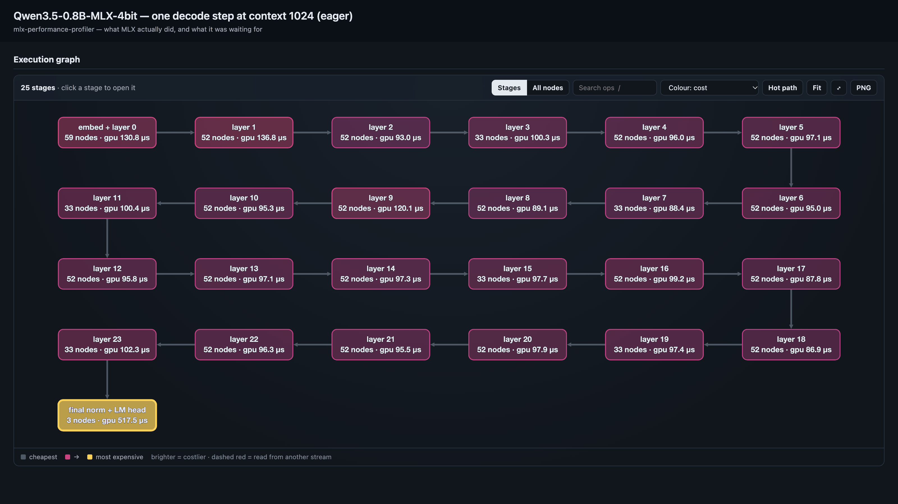
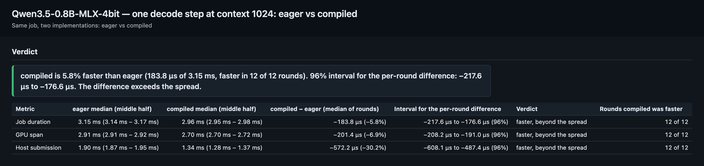
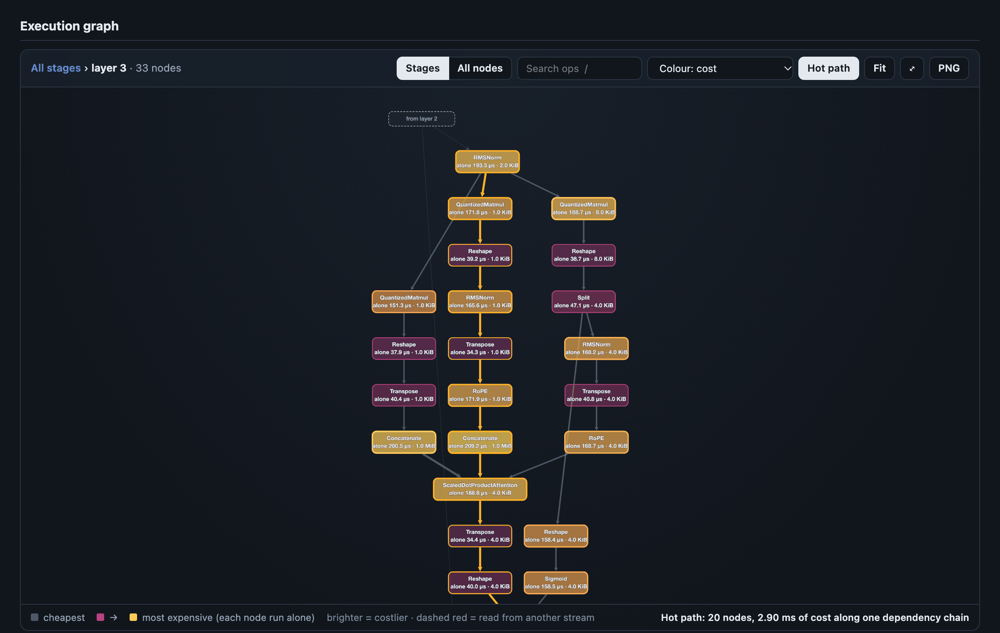
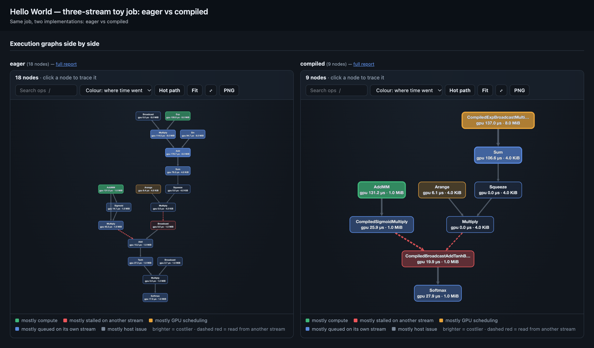
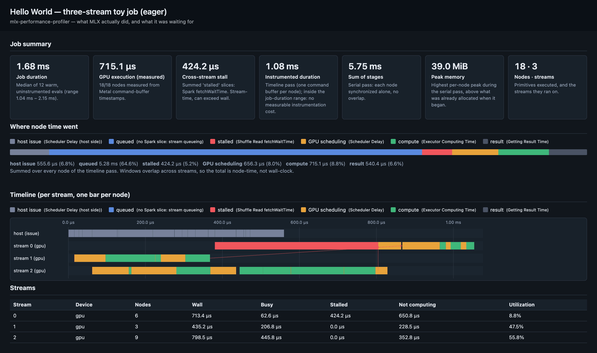
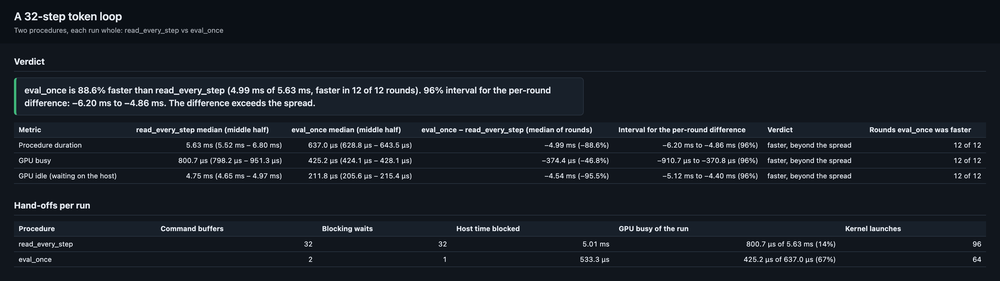

# mlx-performance-profiler

**X-ray vision for Apple MLX. See what the GPU actually did, and prove which version is faster.**



*One decode step of Qwen3.5-0.8B (4-bit), profiled. Each tile is a decoder layer timed on the GPU, and the brighter the tile, the more it cost. The LM head at the end (gold, 517.5 µs) is the most expensive stage, costing about 5× a median decoder layer (97.1 µs). Click any layer in the report to open its operations (up to 59 of them).*

MLX is lazy: you describe a graph, and MLX decides what runs, on which stream, and when. This profiler shows you what it actually did, the way Apache Spark's Web UI shows a query. Every operation, every stream, and every microsecond is split into **computing** and **waiting**. The waiting is broken down further: on the host, behind earlier work on the same GPU stream, or on another stream's data.

## Why you'll want it

- 🔬 **An execution graph you can actually explore.** Every operation MLX ran, coloured by where its time went and brighter the more it cost. Hover for the full breakdown, click to light up everything upstream and downstream, search by op or kernel, and flip on the **hot path**: the most expensive dependency chain, highlighted end to end. Big models open as stages (a decoder's layers) that you drill into.
- 🧩 **The why, not just the what.** Every kernel launch MLX makes is recorded with its Metal function, grid and threadgroup shape. A launch with fewer threadgroups than the GPU has cores is flagged ⚠: in one comparison, the same work took about 30× as long launched as 4 threadgroups as it did as 512 (8.96 ms against 0.30 ms), and the report shows why: 4 threadgroups can keep only 4 of 16 cores busy.
- 🔁 **Whole loops, not just graphs.** A token loop that reads a value back every step evaluates 32 graphs, not one. Hand it two such procedures and it times each one whole, splits the time into GPU busy and GPU *idle*, and counts every hand-off between host and GPU. In one comparison, a 32-step loop that read back each step took about 9× as long as the same loop evaluated once (5.6 ms against 0.6 ms): the GPU sat idle for 4.7 ms of it, across 32 blocking waits against 1.
- ⏱️ **GPU time measured, not guessed.** Compute comes from Metal's own command-buffer timestamps (`GPUStartTime` / `GPUEndTime`), for every node or stage.
- ⚖️ **A verdict, not vibes.** Hand it two versions of a job, say a stock MLX primitive and your custom Metal kernel, and it says which is faster, by how much, and whether that beats run-to-run noise. Identical variants are called different under 4% of the time, and that guarantee is tested, not assumed.
- 🧠 **Real models, proven correct first.** Ships a Qwen3.5 decode step rebuilt from MLX's own kernels, which refuses to profile until it greedily decodes " Paris" after "The capital of France is".
- 📦 **One file, nothing to install to read it.** Each report is a single HTML file that opens offline in any browser. Every number is also written as JSON for scripts, CI and agents, and the whole thing is reachable from C, C++ and Rust through a small C API.



*The verdict that opens every comparison: 12 interleaved, uninstrumented rounds, judged on the per-round differences, so drift the two variants share cancels out.*

<table>
<tr>
<td width="50%"><br><sub><b>Drill into a layer.</b> The hot path (amber) traces the most expensive chain through attention, from RMSNorm through QuantizedMatmul and RoPE into ScaledDotProductAttention.</sub></td>
<td width="50%"><br><sub><b>See what compile changed.</b> The same job, eager (18 nodes) beside <code>mlx::core::compile</code> (9 nodes), with the fused kernels in plain view.</sub></td>
</tr>
<tr>
<td colspan="2"><br><sub><b>Find the stall.</b> The per-stream timeline: stream 0 sits stalled (red) until stream 2's data lands, and the arrow shows which producer it was waiting for.</sub></td>
</tr>
</table>

## Try it in two minutes

```sh
cmake -S . -B build -DMLX_PREFIX=/path/to/mlx/prefix   # a prebuilt MLX, see "MLX compatibility"
cmake --build build
./build/hello_world                                    # then open build/hello_world.html
```

**Documentation:** [the guides](docs/README.md) answer one question each (profile a job, compare two implementations, read the JSON, link it into your build, fix an error), with complete C, CMake, Rust and Python examples the test suite builds and runs. They are also published on [Context7](https://context7.com/aosama/mlx-performance-profiler) for coding agents.

It is an observer: it never changes MLX semantics. Formerly named `mlx-visual-plan`; in code it uses the short prefix `mlx_perf`. See [`PHASED_PLAN.md`](PHASED_PLAN.md) for the roadmap, [`AGENTS.md`](AGENTS.md) for contributor conventions and [`VERSIONING.md`](VERSIONING.md) for how versions relate to MLX's. The images above are the profiler's own reports, captured with [`capture_report_visual.py`](.claude/skills/release-notes/scripts/capture_report_visual.py); the numbers are from single runs on one Apple-silicon Mac and vary from run to run.

## Build

Requires macOS on Apple silicon, CMake ≥ 3.24, a C++20 compiler, and a
prebuilt MLX installation prefix (containing `include/` and `lib/`) of a
tested release (see **MLX compatibility**). `MLX_PREFIX` is a required CMake
cache variable; it is never read from the environment.

```sh
cmake -S . -B build -DMLX_PREFIX=/path/to/mlx/prefix
cmake --build build
```

The build type defaults to Release, matching the prebuilt MLX. Three options
choose what is built and installed; all default to on for this repository
and off when another project includes it:

| Option | Builds |
|---|---|
| `MLX_PERF_BUILD_TOOLS` | `hello_world`, `mlx_perf_server`, `qwen35_profile` |
| `MLX_PERF_BUILD_TESTS` | the test suite |
| `MLX_PERF_INSTALL` | install rules and the `mlx_perf` package (needed by the packaging tests) |

`-DMLX_PERF_BUILD_TOOLS=OFF -DMLX_PERF_BUILD_TESTS=OFF` builds the library
alone, in seconds.

Nothing else is needed: the interactive graph view's libraries
([Cytoscape.js](https://js.cytoscape.org/) and its dagre layout, both MIT,
vendored in [`third_party/`](third_party/README.md)) are compiled into the
library, so every report is one HTML file that works offline.

## Use it from another build

The installed surface is the C API (`include/mlx_perf/mlx_perf_c_api.h`) and
one archive, `libmlx_perf.a`. It holds only this repository's code: MLX
comes from the consumer's own prefix, so the final binary links exactly one
MLX.

**Installed package (CMake):**

```sh
cmake -S . -B build -DMLX_PREFIX=/path/to/mlx/prefix \
      -DMLX_PERF_BUILD_TOOLS=OFF -DMLX_PERF_BUILD_TESTS=OFF
cmake --build build
cmake --install build --prefix /path/to/install
```

```cmake
# In the consumer: cmake -DMLX_PREFIX=... -DCMAKE_PREFIX_PATH=/path/to/install
find_package(mlx_perf 0.6 REQUIRED)
target_link_libraries(my_test PRIVATE mlx_perf::mlx_perf)
```

The package attaches MLX from the consumer's `MLX_PREFIX`. That MLX must be
the release the archive was built against; the package names both releases
if they differ. Without `REQUIRED`, a missing `MLX_PREFIX` makes the package
report itself not found instead of stopping your configure.

**From source (FetchContent or `add_subdirectory`):**

```cmake
include(FetchContent)
FetchContent_Declare(mlx_perf
  GIT_REPOSITORY https://github.com/aosama/mlx-performance-profiler.git
  GIT_TAG v0.6.0)
FetchContent_MakeAvailable(mlx_perf)   # with -DMLX_PREFIX=... on your command line
target_link_libraries(my_test PRIVATE mlx_perf::mlx_perf)
```

Only the library is built (no tools, tests or install rules), optimised
even when your build sets no build type, and only the C API's headers reach
your include path.

**Cargo:** link `static=mlx_perf` from the installed `lib/` in your own
`build.rs` (`cargo:rustc-link-search=native=<prefix>/lib`) and let the MLX
binding crate (e.g. `mlx-bridge`) link MLX.
[`rust/mlx_perf_rust_example`](rust/mlx_perf_rust_example) shows the same
from this repository's build directory; it does not read an installed
prefix.

`tests/packaging/` holds a C program built both ways. The test suite
installs the library into a scratch prefix and builds, links and runs the
program against it. It also builds and links the program through the
`FetchContent` declaration above, pointed at the checkout under test with
`FETCHCONTENT_SOURCE_DIR_MLX_PERF` so nothing is downloaded.

## MLX compatibility

| | |
|---|---|
| Tested MLX releases | 0.32.4, 0.32.5: the full test suite and a Qwen3.5 run pass on each |
| Backend | Metal (macOS); Linux and CUDA are tracked in #15 |

Configure prints the MLX release it found and warns, without failing, when
it is not a tested one. Beyond MLX's public API, the library relies on five
things; a locally patched MLX that keeps them works:

1. `mlx/backend/metal/device.h`: `get_command_encoder(stream).get_command_buffer()`,
   and every `async_eval` ending by committing the stream's current command
   buffer.
2. `array::is_available()` as a non-blocking completion check.
3. `Primitive::name()` and `Primitive::stream()`.
4. MLX-C's handle layout: an `mlx_array`'s context is a heap
   `mlx::core::array` (pinned by a test in `mlx_perf_c_api_test`).
5. `mlx::core::fast::CustomKernel`'s `state()` holding the kernel's name
   first (read through a checked `dynamic_cast`; without it, custom kernels
   simply get no `kernel_name`).

## Run

```sh
./build/hello_world
```

Measures one small three-stream job two ways, **eager** and through
`mlx::core::compile`, as an interleaved pair (see **Comparing two
implementations**). Each variant goes through four passes on freshly built,
identical graphs. It prints a job summary, a per-stream table and a per-node
latency breakdown per variant, and writes three reports:

- `build/hello_world.html`: **eager vs compiled** side by side, opening with
  the verdict (which is faster, by how much, and whether that exceeds the
  spread), then metric deltas, both execution graphs, both timelines on one time scale,
  and which primitives compile fused.
- `build/hello_world_eager.html` and `build/hello_world_compiled.html`: the
  full Spark-style report for each variant.

Beside each variant's report it writes the same measurement as data,
`build/hello_world_eager.json` and `build/hello_world_compiled.json`, and
the comparison as `build/hello_world.json` (see **Per-node measurements as
data**).

The four passes per variant:

| Pass | What it measures |
|---|---|
| 0. warm-up | discarded — absorbs Metal kernel compilation |
| 1. pipeline | **job wall**: median of 7 uninstrumented runs (one `async_eval`, streams overlap), with the spread |
| 2. timeline | per-node issue and host-observed completion with overlap preserved, plus each node's **GPU execution window** read from its Metal command buffer (`GPUStartTime`/`GPUEndTime`) → `wait_on_cpu` / `wait_on_gpu` / `wait_on_dependency` / `scheduler_delay` / `compute` / result latency, and the cross-stream stall (Spark `fetchWaitTime` analog) |
| 3. attributed | **sum-of-stages**: each node synchronized alone |

Every number is printed next to what it is and is not. Per-node `compute` is
GPU-measured at command-buffer granularity (one buffer per node in the
timeline pass); a `~` marks the rare fallback to a host-observed residual
(CPU-stream nodes).

## Live view

```sh
./build/mlx_perf_server            # or: --port 9000
```

Open <http://127.0.0.1:8765/>. The server measures the job, eager against
compiled, as an interleaved pair (see **Comparing two implementations**)
and serves Spark-UI-like tabs:

- **Job:** the verdict, then the single-figure comparison table and each
  variant's summary cards.
- **Stages:** per-stream Gantt and stream table.
- **Tasks:** the sortable per-node table.
- **Memory:** a live process-memory chart sampled at 1 Hz, plus the nodes
  that added the most memory.

**Re-run** measures again. The status line and tabs update over
Server-Sent Events, so there's no page refresh. The server listens on
127.0.0.1 only; Ctrl-C stops it.

### Previewing inside the Claude desktop app

[`.claude/launch.json`](.claude/launch.json) tells the Claude desktop app
(Code tab) how to start two local servers in its built-in browser pane, so
Claude can open and click through the views with you:

| Name | Port | What it serves |
|---|---|---|
| `mlx-perf-live` | 8765 | the live view above (`./build/mlx_perf_server`) |
| `mlx-perf-reports` | 8766 | the static HTML reports in `build/` (e.g. `/hello_world.html`, `/qwen35_decode.html`), via `python3 -m http.server` |

The reports server exists because the browser pane does not open local
`file://` pages. Both bind to 127.0.0.1 only. Build first (see **Build**):
the live server needs `build/mlx_perf_server`, and the reports server needs
reports already written to `build/`. Outside the app, run the same commands
in a terminal; the file is ignored by everything else.

## Profiling a real model (Qwen3.5)

```sh
./build/qwen35_profile /path/to/Qwen3.5-0.8B-MLX-4bit            # or: --context 4096
```

This loads a dense Qwen3.5 MLX checkpoint (4- or 8-bit; the bit width is
derived per layer). It rebuilds the whole model in C++ from MLX's production
kernels: quantized matmul, RMSNorm, RoPE, fused attention, and the fused
Gated DeltaNet update.

It **first proves the math**: greedy decoding of "The capital of France is"
must continue with " Paris", or the tool refuses to profile. Then it measures
one decode step at the given context length, eager vs compiled, and writes
`build/qwen35_decode.html` plus a report and a measurement file
(`build/qwen35_decode_<variant>.json`) per variant.

### Stage granularity

The timeline pass issues one `async_eval` per timed unit, and each one
commits at least one Metal command buffer. At about 1,100 nodes per step,
one buffer per node costs several times the real step (eager: 24.2 ms
instrumented for a 3.1 ms step), so nearly every node reads as queued behind
the instrumentation. The profiler therefore times **stages** when the job names
them and the graph is large (≥ 256 primitives). Here a stage is one decoder
layer (Spark's stage), and it costs one `async_eval`:

| Qwen3.5-0.8B-4bit, context 1024 | job wall | per-node timeline | per-stage timeline |
|---|---|---|---|
| eager (1,144 nodes, 25 stages) | 3.15 ms | 24.19 ms (7.7×) | 3.61 ms (1.14×) |
| compiled (766 nodes, 25 stages) | 2.92 ms | 11.29 ms (3.8×) | 3.06 ms (1.05×) |

With the instrumentation out of the way, the waiting breakdown means
something again. The host takes about 80–210 µs to encode each eager layer,
and the GPU takes about 75–145 µs to run it. So the second half of the eager
step is classed `wait_on_cpu` (host-bound encoding), while the first half
and most compiled stages are `queued` (the host ran ahead of the GPU). The
LM head (a 248k-row quantized matmul) is the largest single stage, at
~0.55 ms.

```sh
./build/qwen35_profile /path/to/model --granularity node     # force per-node (or: stage, auto)
```

What a stage row measures: its GPU window runs from the GPU start of the
stage's first command buffer to the end of its last. MLX commits mid-stage
when a buffer exceeds its op budget, and the probe cannot see those middle
buffers. The end is therefore taken from an empty marker buffer queued
behind the stage on the same Metal queue, tightened by host-observed
completion. Compute includes any GPU gap while the host was still encoding
the stage. Members of a stage finish together, so per-node waiting is not
observable in this mode; per-node detail stays the default for small graphs.
A job supplies stages by overriding `GraphFactory::build_fresh_staged_graph`.
The profiler itself knows nothing about Qwen.

## From Rust (mlx-bridge)

The same measurement and report are available through a C API
(`include/mlx_perf/mlx_perf_c_api.h`). [`rust/mlx_perf_rust_example`](rust/mlx_perf_rust_example)
builds a three-stream job with `mlx-bridge` and profiles it:

```sh
cmake --build build                      # builds libmlx_perf.a
cd rust/mlx_perf_rust_example
cargo profile-job                        # writes build/rust_example.html and .json
```

It expects the `mlx-bridge` checkout as a sibling directory and uses that
crate's pinned nightly toolchain. The final binary links exactly one MLX: the
static `libmlx_perf.a` contains only this repository's code, and it resolves
MLX from the same prebuilt prefix the bridge links.

## Comparing two implementations

A kernel author's question is rarely "how long does this take" but "is my
version faster than the stock one, and is the difference real". The C API
answers it for two graphs that compute the same result:

```c
mlx_perf_variant stock  = {"stock",  build_stock_graph,  &stock_payload};
mlx_perf_variant custom = {"custom", build_custom_graph, &custom_payload};
mlx_perf_comparison_summary summary;
mlx_perf_compare_to_report(&stock, &custom, "My projection", "build", "projection", &summary);
```

(From C++, `measure_pair` and `write_report_bundle` do the same with two
`GraphFactory`s.) What it does:

- **Checks the two outputs agree** in count, shape and dtype before timing
  anything, and reports the largest value difference (never enforced: a
  custom kernel may differ in the last bits).
- **Interleaves the passes:** 12 rounds, each running both variants
  uninstrumented (one `async_eval`, as a plain eval submits the job) with
  the order flipped every round, so drift on a machine doing other work
  lands on both and each variant runs first exactly half the time.
- **Measures three things per round, all uninstrumented:** job duration;
  host submission (host time inside that single `async_eval`); and GPU span
  (12 more rounds that time the whole job as one unit per stream, from its
  first command buffer starting to its last one ending).
- **Judges each metric on the per-round differences** (candidate −
  baseline), so drift both variants share within a round cancels. A
  difference counts only when the whole 96% interval for the median
  per-round difference lies on one side of zero: the candidate won (or
  lost) at least 10 of the 12 rounds. One or two disturbed rounds cannot
  decide it, and two identical variants are called different under 4% of
  the time per metric. The exact sign-test p-value is in the JSON.

Then one per-node timeline per variant draws the DAG, Gantt and task table.
It is instrumented (each node submitted on its own) and is never used for
the verdict.

Why pairing matters, measured on the Qwen3.5 decode step: job wall stepped
up by about 1 ms part-way through each run. Measured one variant after the
other, compiled read 4.2 ms against eager's 3.2 ms, because it ran later and
absorbed the step. Interleaved, compiled is faster in every round.

The comparison page opens with one sentence. For the Qwen3.5 decode step,
eager against compiled: *"compiled is 5.6% faster than eager (175.2 µs of
3.11 ms, faster in 12 of 12 rounds). 96% interval for the per-round
difference: −188.8 µs to −164.4 µs. The difference exceeds the spread."*
When the interval includes zero, it says the difference is not a result.
It writes `<base>.html` and `<base>.json`, plus a report and a measurement
file per variant.

The suite's acceptance test is a separate example: one 4-bit quantized
projection, computed by `quantized_matmul` against `dequantize` followed by
`matmul`. The fused kernel wins beyond the spread.

## Comparing procedures: loops and pipelines



*A 32-step loop written two ways, from the documented example: one run on one Mac.*

A token loop, a sampler or a pipeline with host code between evaluations is
not one graph. `mlx_perf_compare_procedures_to_report` compares two of them
measured whole: `run` is timed from its start until every command buffer it
committed has completed, and an optional `prepare` resets state, untimed,
before every run.

```c
mlx_perf_procedure reading = {"read_every_step", prepare_loop, run_loop, &reading_loop};
mlx_perf_procedure batched = {"eval_once",       prepare_loop, run_loop, &batched_loop};
mlx_perf_procedure_comparison_summary summary;
mlx_perf_compare_procedures_to_report(&reading, &batched, "A 32-step loop", "build", "token_loop", &summary);
```

The same 12 interleaved rounds and the same verdict judge three metrics:
the duration, **GPU busy** (time at least one of the run's command buffers
was on the GPU, from Metal's timestamps) and **GPU idle** (the rest: the GPU
waiting on the host). Hooks on MLX's Metal command buffers and events count
each run's command buffers and blocking waits, the hand-offs in which
neither side can run ahead. The page shows them per run, with every kernel
launch grouped by Metal function. The full example and guide:
[Comparing procedures](docs/comparing-procedures.md).

## Wired memory: how much room the GPU has

On Apple silicon the GPU's memory is wired, and macOS keeps wired memory
under a system-wide limit (`vm.global_user_wire_limit`). Every report and
procedure comparison now has a **Wired memory** lane: the system's wired
total, MLX's own holding and the part wired outside MLX, against the limit,
with each MLX release and how long macOS took to un-wire it.

Measured with it on one Apple silicon Mac: memory MLX releases stays wired about 0.2 s
longer, so the "wired outside MLX" figure an engine sizes against jumps by
the released amount for that long. Memory MLX still holds is un-wired after
about a second without GPU use, so that figure also reads low while memory
sits idle. `mlx_perf_read_wired_memory` takes the same reading from your own
code after any evaluation, and `mlx_perf_measure_wire_release_lag` measures
the release lag on your Mac. Guide: [Wired memory](docs/wired-memory.md).

## Memory, judged like time

Many engine changes are memory decisions first. Both comparisons judge each
run's peak MLX working set, what it left behind, and the system's wired
total at its end, on the same interleaved rounds and with the same verdict
as the times, read just before and just after each run so the timing pays
nothing for them. When a round crossed the wire limit or made the system
compress memory, the page says so beside the timing verdict: such a round is
slow for a reason outside the code. Guide:
[Comparing procedures](docs/comparing-procedures.md#memory-judged-on-the-same-rounds).

## Quiet output for library use

The library prints progress and file lines to stdout and errors to stderr.
A consumer whose own output must stay machine-readable switches that off:

```c
mlx_perf_set_console_output(0);   /* 1 (the default) switches it back on */
```

Off, nothing is printed; failures still come back as return codes and
`mlx_perf_last_error()`.

## Per-node measurements as data

Every profile also writes its measurements as JSON beside the report: one
record per node in execution order, with each node's GPU execution window,
the six slices, how long its stream's GPU sat idle before it, and its
serial-pass time and memory. There is also a job record with every
job-wall sample and the time spent inside the job's own graph-building
code. `mlx_perf_profile_to_measurements` writes the file alone, without
the report.

```sh
jq '.nodes[] | {op_name, compute_us, gpu_idle_before_us}' \
   build/hello_world_eager.json
```

Unmeasured values are `null`, never zero. Every field is described in
[`docs/measurement-file.md`](docs/measurement-file.md).

## Reading the report

Open `build/hello_world.html` for the comparison, or a variant report, in any
browser. Each is self-contained, works offline and follows the system
light/dark theme. A variant report reads top to bottom like a Spark StagePage:

1. **Job summary.** Cards for job duration (the honest end-to-end number),
   measured GPU execution, cross-stream stall, instrumented duration, sum of
   stages and peak memory. Under them, **where node time went** is one stacked
   bar over all nodes.
2. **Timeline (per stream).** A Gantt with one lane for the host thread that
   issues nodes and one lane per MLX stream. On a stream lane, **red = stalled**
   on another stream's data, **amber = GPU scheduling**, **green = measured GPU
   execution**, and blank means nothing was runnable. Arrows run from a
   producer's GPU end to where its cross-stream consumer stopped waiting.
   Below it is a per-stream table with busy, stalled and utilization.
3. **Tasks.** One sortable row per executed node: each slice, wall, the same
   node timed alone ("Serial"), its class, and a stacked latency bar. In a
   stage-timed report, one row per stage and stream instead, with the ops
   inside it and the members' serial times summed.
4. **Execution graph.** Every operation MLX executed, drawn from the same
   measurement document the JSON file holds. Each node is coloured by where
   its time went (the timeline's colours) and is brighter the more it cost;
   a dashed red edge is a read from another stream. Hover a node for its
   six-slice breakdown; click it to light up everything upstream and
   downstream. Search by op or kernel name, highlight the **hot path** (the
   most expensive dependency chain), switch colours to cost or stream, go
   full screen, or download the whole graph as a PNG. A stage-timed report
   opens on its stages (a decoder's layers); click one to open its nodes.
   The `.dot` file beside the report still holds the plan for Graphviz.

The six slices, in causal order, always sum to a node's wall:

| Slice | Meaning | Spark analog |
|---|---|---|
| host issue | host time inside `async_eval` | Scheduler Delay (host) |
| queued | earlier work on the same stream still running | — |
| stalled | input from another stream not ready yet | Shuffle Read `fetchWaitTime` |
| GPU scheduling | committed, GPU not started yet | Scheduler Delay |
| compute | GPU execution of the node's command buffer | Executor Computing Time |
| result | GPU done → host noticed (never decides the class) | Getting Result Time |

## Test

```sh
ctest --test-dir build --output-on-failure
```

`latency_breakdown_test` and `stage_plan_test` are GPU-free unit tests of
the decomposition and the stage grouping; `gpu_timeline_test` and
`stage_timeline_test` are integration tests that run on the Metal GPU.
The `should_*` tests from `tests/packaging/` check the installed package:
they install into a scratch prefix under `build/`, then build and run a C
consumer against it, and check the refusals (no `MLX_PREFIX`, a different MLX
release, a different minor version).

## License

Apache License 2.0 — see [`LICENSE`](LICENSE).
