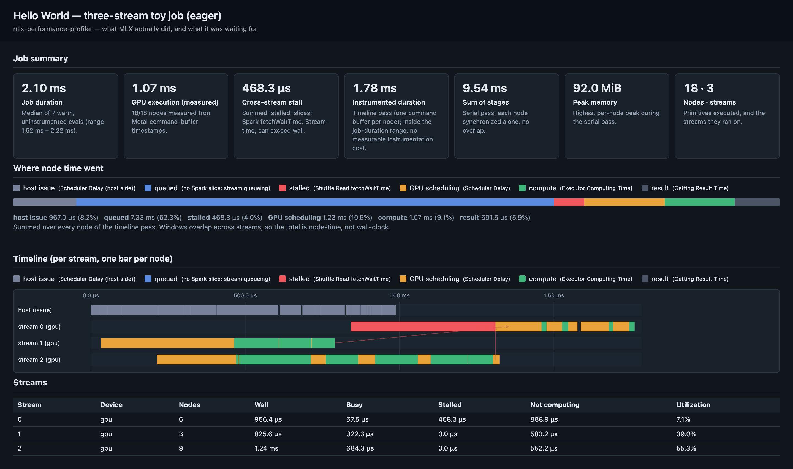

# mlx-performance-profiler 0.1.0: see what MLX actually did



*Drawn by the profiler itself: a 0.1.0 report of the bundled three-stream demo. GPU time comes from Metal's own timestamps; stream 0 sits stalled (red) until stream 2 delivers its data, and the arrow names the producer it waited for. Numbers from one run on one Mac.*

The first release of a profiler for [Apple MLX](https://github.com/ml-explore/mlx) computations, in the spirit of Apache Spark's Web UI. Hand it an MLX job and it reports, node by node and stream by stream, how much time went to **computing** and how much to **waiting**: on the host, on the node's own GPU stream, or on another stream's data. It measures GPU execution from Metal's own timestamps rather than inferring it. It also scales to a real model: on a Qwen3.5-0.8B decode step it rebuilds the model, proves the output correct, then times each of the 24 decoder layers.

## Highlights

**GPU time, measured, for every node (#2).** Each node's execution window is read from its Metal command buffer (`GPUStartTime` / `GPUEndTime`), so "compute" is what the GPU did, not a guess. Every node's wall time splits into six slices that always sum to it: host issue, queued, stalled on another stream, GPU scheduling, compute, result. These follow the Spark StagePage's decomposition, so the familiar Spark questions apply.

**A report you can read top to bottom (#3, #4, #5).** One self-contained HTML page per job:
- a job summary;
- a per-stream Gantt with cross-stream stalls drawn in red;
- a sortable task table;
- the DAG.

Eager and `mlx::core::compile` variants sit side by side on one time scale. On the bundled demo, compile halves the executed nodes (18 → 9) and turns a 5-kernel elementwise chain into one ~270 µs kernel. A live local server shows the same views with a Re-run button.

**Real models, proven correct first (#8, #9).** `qwen35_profile` rebuilds a dense Qwen3.5 MLX checkpoint in C++ from MLX's production kernels, and refuses to profile until greedy decoding of "The capital of France is" continues with " Paris". Profiling it found a dtype promotion costing 2.5 ms per token (514 `AsType` nodes); after the fix the eager step went from 5.6 to 3.1 ms. Timing one decoder layer per dispatch keeps the profiler's own overhead small: the instrumented eager step reads 3.61 ms against a real 3.15 ms, where timing every node read 24.19 ms (7.7×).

**Usable from another build (#6, #13, PR #17).** A C API (`mlx_perf_profile_to_report`) profiles any graph built through MLX-C, from C, C++ or Rust. The library installs as one archive with a `find_package(mlx_perf)` package that links MLX from your own prefix, so your binary keeps exactly one MLX.

## Get started

Build from source with CMake `FetchContent`, against your own prebuilt MLX:

```cmake
include(FetchContent)
FetchContent_Declare(mlx_perf
  GIT_REPOSITORY https://github.com/aosama/mlx-performance-profiler.git
  GIT_TAG v0.1.0)
FetchContent_MakeAvailable(mlx_perf)      # configure with -DMLX_PREFIX=/path/to/mlx/prefix
target_link_libraries(my_test PRIVATE mlx_perf::mlx_perf)
```

Or install it and use the package:

```sh
cmake -S . -B build -DMLX_PREFIX=/path/to/mlx/prefix -DMLX_PERF_BUILD_TOOLS=OFF -DMLX_PERF_BUILD_TESTS=OFF
cmake --build build && cmake --install build --prefix /path/to/install
```

```cmake
find_package(mlx_perf 0.1 REQUIRED)       # with -DMLX_PREFIX=... -DCMAKE_PREFIX_PATH=/path/to/install
target_link_libraries(my_test PRIVATE mlx_perf::mlx_perf)
```

Profile a job: describe it as a callback that builds a fresh, unevaluated graph each time it is called.

```c
#include "mlx_perf/mlx_perf_c_api.h"

static int build_job(mlx_vector_array fresh_outputs, void* payload) {
  /* build the graph with MLX-C, then mlx_vector_array_append_value(fresh_outputs, output) */
  return 0;
}

mlx_perf_job_summary summary;
if (mlx_perf_profile_to_report(build_job, NULL, "my-job", "My job", "build", "my_job", &summary) != 0) {
  fprintf(stderr, "%s\n", mlx_perf_last_error());
}
/* open build/my_job.html */
```

Pin the source archive: [`mlx-performance-profiler-0.1.0.tar.gz`](https://github.com/aosama/mlx-performance-profiler/releases/download/v0.1.0/mlx-performance-profiler-0.1.0.tar.gz), SHA-256 `615653f67d9061e06237094a7ed0d281d519f69886bbecab668af9e5cd8ca19b`.

Full documentation: [README at v0.1.0](https://github.com/aosama/mlx-performance-profiler/blob/v0.1.0/README.md).

## What's new

Everything; this is the first release. The pieces, in the order they were built:

- **Timeline that keeps streams overlapping (#1).** Each node is dispatched with its own `async_eval` and observed complete by polling, so streams still run concurrently while being timed.
- **Measured GPU execution (#2).** Metal command-buffer timestamps on the host clock. No `.gputrace` parsing.
- **Spark-style HTML report (#3).** Summary cards, per-stream Gantt, sortable task table, DAG.
- **Eager against compiled (#4).** A comparison page with metric deltas, both DAGs, both timelines and the primitive mix.
- **Live server (#5).** `mlx_perf_server`: Job, Stages, Tasks and Memory tabs, refreshed over Server-Sent Events.
- **C API and Rust example (#6).** Profile jobs built with the Rust MLX-C bindings (`mlx-bridge`).
- **Qwen3.5 decode step (#8).** A real model, rebuilt in C++ and proven correct before it is profiled.
- **Stage granularity (#9).** One decoder layer per timed unit on large graphs. A job names its stages; the profiler stays model-agnostic.
- **Packaging (#13, PR #17).**
  - An installable library with a CMake package.
  - Library-only builds in about 4 seconds.
  - A versioned C header (`MLX_PERF_VERSION_*`, `mlx_perf_version()`).
  - A refusal at configure time when your MLX release differs from the one the archive was built against.
  - The canonical Apache-2.0 licence.
- **The project's name (PR #16).** Renamed from `mlx-visual-plan`; code uses the prefix `mlx_perf`.

## Upgrading

Nothing to upgrade from: this is the first release.

## Fixes

None to list in a first release. See "Known limitations" for defects found later.

## Compatibility

- **MLX:** the declared tested releases are 0.32.4 and 0.32.5. The release's own test run used MLX 0.32.5; earlier development ran on 0.32.4. Metal backend, macOS on Apple silicon. Configure warns, but continues, on an untested release.
- **C API:** `mlx_perf_profile_to_report`, `mlx_perf_last_error`, `mlx_perf_version`.
- **Versioning:** the project's own SemVer ([`VERSIONING.md`](https://github.com/aosama/mlx-performance-profiler/blob/v0.1.0/VERSIONING.md)). Before 1.0 a minor release may change the C API, and the package accepts the same minor version only (`find_package(mlx_perf 0.1)` matches 0.1.x).

## How this release was verified

- **Tests:** 38 tests, covering unit, component, Metal integration, and packaging, all passing on MLX 0.32.5. The packaging tests install the library into a scratch prefix, then build, link and run a C consumer against it.
- **Real model:** `qwen35_profile` decoded " Paris" before profiling a Qwen3.5-0.8B-MLX-4bit decode step.

## Known limitations and what's next

Found after 0.1.0, all fixed in [0.2.0](https://github.com/aosama/mlx-performance-profiler/releases/tag/v0.2.0):
- **Order bias in the eager-against-compiled comparison.** The two variants are measured one after the other, so drift on the machine lands on one of them only. In one measurement of the Qwen3.5 step, compiled read 4.2 ms against eager's 3.2 ms because it ran second, while interleaved runs show it faster in every round. 0.2.0 interleaves the runs and judges the difference against the spread (#12).
- **A shell-quoting defect.** The Graphviz step ran through a shell with the report name inside double quotes, where `$(…)` still executes. Use plain report names on 0.1.0; 0.2.0 runs Graphviz without a shell.
- **Rough edges for projects building from source:** the library's internal headers reach their include path, and a build with no build type compiles the profiler unoptimised.
- **Results only as HTML.** 0.2.0 adds per-node data as JSON (#11).

Tracked for later: other-language bindings (#14), Linux with CUDA (#15), continuous integration (#20).

## For agents

```yaml
release: 0.1.0
tag: v0.1.0
previous_release: null
repository: aosama/mlx-performance-profiler
source_archive:
  url: https://github.com/aosama/mlx-performance-profiler/releases/download/v0.1.0/mlx-performance-profiler-0.1.0.tar.gz
  sha256: 615653f67d9061e06237094a7ed0d281d519f69886bbecab668af9e5cd8ca19b
cmake:
  find_package: "find_package(mlx_perf 0.1 REQUIRED)"
  target: mlx_perf::mlx_perf
  requires: MLX_PREFIX pointing at the MLX release the archive was built against
tested_mlx_releases: ["0.32.4", "0.32.5"]   # declared
verified_on_mlx: ["0.32.5"]                 # the release's own test run
platform: macOS, Apple silicon, Metal
c_api:
  header: include/mlx_perf/mlx_perf_c_api.h
  added: [mlx_perf_profile_to_report, mlx_perf_last_error, mlx_perf_version]
  removed: []
file_formats: {}
shipped_issues: [13]
opening_visual: https://raw.githubusercontent.com/aosama/mlx-performance-profiler/main/release-notes/media/v0.1.0-timeline.png
superseded_by: 0.2.0
docs:
  readme: https://github.com/aosama/mlx-performance-profiler/blob/v0.1.0/README.md
  changelog: https://github.com/aosama/mlx-performance-profiler/blob/v0.1.0/CHANGELOG.md
```

**Full history:** https://github.com/aosama/mlx-performance-profiler/commits/v0.1.0
