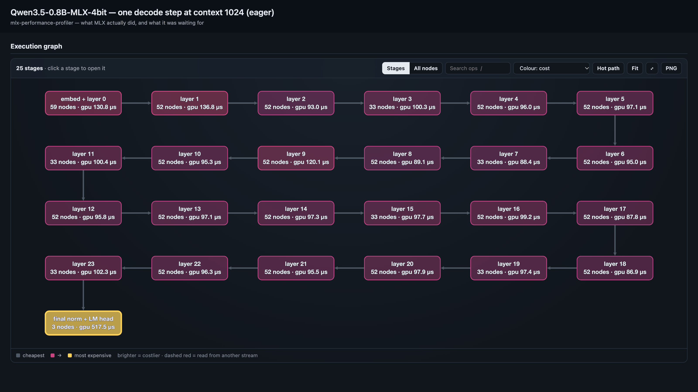

# mlx-performance-profiler 0.3.0: explore what MLX ran, in an interactive graph



*Drawn by the profiler itself: the execution graph of a 0.3.0 report for one Qwen3.5-0.8B (4-bit) decode step at context 1024, coloured by cost. Each tile is a stage timed on the GPU; the LM head (517.5 µs, gold) costs about 5× a median decoder layer (97.1 µs). Click a tile in the report to open its operations. One run on one Mac.*

Every report now opens its execution graph as something you can explore, not a static picture you squint at. Each operation MLX ran is coloured by where its time went and glows brighter the more it cost. Hover any node for its timing breakdown, click it to trace everything upstream and downstream, or press **Hot path** to light up the most expensive dependency chain. A real model opens as its layers: Qwen3.5's decode step shows as 25 stages you can drill into, where the old drawing was 1,144 boxes too small to read. Graphviz is no longer needed, and every report is still one HTML file that works offline.

## Highlights

**Explore the graph instead of squinting at it (#30, #31).** The execution graph used to be a Graphviz drawing: fine for a toy job, unreadable for a model. It is now an interactive view built on [Cytoscape.js](https://js.cytoscape.org/). Each node is coloured by its dominant latency slice, in the same colours as the timeline (green compute, red stalled on another stream, amber GPU scheduling, blue queued), and its fill strength grows with its cost. Hover shows the node's op, kernel, shape, bytes, stream and six-slice bar; click dims everything except what feeds it and what it feeds; search finds an op or kernel by name; a toolbar switches colours to cost or stream, goes full screen, or downloads the whole graph as a PNG.

**See the most expensive chain at a glance (#30).** **Hot path** highlights the longest chain by cost through the graph, end to end, and says how much it adds up to. Inside one Qwen3.5 decoder layer it traces the attention path, from RMSNorm through QuantizedMatmul and RoPE into ScaledDotProductAttention.

**Big models open as stages (#30).** A stage-timed job, such as a decoder timed one layer at a time, opens on its stages. A simple chain of stages is laid out as a snake that fills the screen, so all 25 Qwen3.5 stages fit at a readable size. Click a stage to open its operations, with its neighbouring stages shown as dashed tiles marking where data comes in and goes out; **All nodes** lays out the whole graph on request.

**Nothing extra to install, and the picture matches the data (#30).** The graph view reads the same measurement document the profiler writes to disk (schema version 1, from #11), so the graph and the JSON file show the same numbers by construction. Graphviz is no longer used, so reports look the same on every machine.

## Get started

**From source with CMake FetchContent:**

```cmake
include(FetchContent)
FetchContent_Declare(mlx_perf
  GIT_REPOSITORY https://github.com/aosama/mlx-performance-profiler.git
  GIT_TAG v0.3.0)
FetchContent_MakeAvailable(mlx_perf)   # with -DMLX_PREFIX=... on your command line
target_link_libraries(my_test PRIVATE mlx_perf::mlx_perf)
```

**As an installed package:**

```sh
git clone --branch v0.3.0 https://github.com/aosama/mlx-performance-profiler.git
cd mlx-performance-profiler
cmake -S . -B build -DMLX_PREFIX=/path/to/mlx/prefix \
      -DMLX_PERF_BUILD_TOOLS=OFF -DMLX_PERF_BUILD_TESTS=OFF
cmake --build build
cmake --install build --prefix /path/to/install
```

```cmake
# In the consumer: cmake -DMLX_PREFIX=... -DCMAKE_PREFIX_PATH=/path/to/install
find_package(mlx_perf 0.3 REQUIRED)
target_link_libraries(my_test PRIVATE mlx_perf::mlx_perf)
```

`MLX_PREFIX` points at a prebuilt MLX of a tested release (0.32.4 or 0.32.5). An installed package accepts only the MLX release it was built against.

**Pinning the source archive:**

```sh
curl -LO https://github.com/aosama/mlx-performance-profiler/releases/download/v0.3.0/mlx-performance-profiler-0.3.0.tar.gz
curl -LO https://github.com/aosama/mlx-performance-profiler/releases/download/v0.3.0/mlx-performance-profiler-0.3.0.tar.gz.sha256
shasum -a 256 -c mlx-performance-profiler-0.3.0.tar.gz.sha256
```

The archive's SHA-256 is `f8c0b7695e3925fd9be0355cecc7b45ed8f5473f27725853d54d977f7f579cc4`.

**See the graph:** build the tools (the default in this repository) and run the bundled demo, then open its report and scroll to **Execution graph**:

```sh
cmake -S . -B build -DMLX_PREFIX=/path/to/mlx/prefix && cmake --build build
./build/hello_world          # writes build/hello_world.html and a report per variant
open build/hello_world_eager.html
```

Any report from `mlx_perf_profile_to_report` or `mlx_perf_compare_to_report` has the same view; the comparison page shows both variants' graphs side by side.

Full documentation at this tag: [Reading the report](https://github.com/aosama/mlx-performance-profiler/blob/v0.3.0/README.md#reading-the-report), [Use it from another build](https://github.com/aosama/mlx-performance-profiler/blob/v0.3.0/README.md#use-it-from-another-build).

## What's new

**Interactive execution graph (#30, #31).** Replaces the Graphviz DAG in every report and comparison page. Cytoscape.js 3.35.0 and cytoscape-dagre 4.1.0 (which bundles the dagre layered layout) are vendored in [`third_party/`](https://github.com/aosama/mlx-performance-profiler/blob/v0.3.0/third_party/README.md) with their MIT licences and SHA-256 checksums, and compiled into `libmlx_perf.a` at build time. The viewer itself is this project's own JavaScript in `src/graph_view/`. Each mounted view can also be driven from a page script (`mlxPerfGraphView.mountedViews[0].openStage(3)`, `setColourMode('heat')`, `showHotPath()`), which is how the release images are captured.

**Release pages open with a picture the profiler drew (#31).** The in-repo `release-notes` skill now captures the opening image from the release's own build with `capture_report_visual.py`, which renders chosen sections of a real report in headless Chrome. The README opens with a gallery of real reports, and the 0.1.0 and 0.2.0 release pages now open with theirs.

## Upgrading from 0.2.0

1. Move version pins to 0.3: `find_package(mlx_perf 0.3 REQUIRED)` or `GIT_TAG v0.3.0`.
2. Reports no longer write `<base>.svg`. If a script of yours reads that file, render `<base>.dot` with Graphviz yourself; the `.dot` file is still written.
3. Graphviz can be uninstalled if nothing else needs it.

Nothing else changes: the C API (functions, structs and their layouts), the measurement file and the comparison record (schema version 1), and every number the profiler measures are the same as in 0.2.0.

## Compatibility

- **MLX:** the declared tested releases are 0.32.4 and 0.32.5. This release's own test run used MLX 0.32.5; it was not re-run against 0.32.4, which continuous integration (#20) is meant to cover. Metal backend, macOS on Apple silicon.
- **Browsers:** the report's graph needs JavaScript and a current browser; without JavaScript the rest of the report still reads, and the graph section says it needs JavaScript.
- **Report size:** each report now carries about 0.5 MB of embedded libraries. Model reports get smaller (the Qwen3.5 eager report went from 3.0 MB to 1.7 MB, the comparison page from 4.5 MB to 2.5 MB, because the Graphviz SVG is gone); small reports get larger (the demo's eager report went from about 80 KB to about 600 KB).
- **Source archive size:** 2.1 MB, up from 0.2 MB in 0.2.0, because it now carries the vendored libraries and the README and release images.
- **C API:** unchanged; nothing added or removed.
- **File formats:** measurement file and comparison record, both `schema_version` 1, unchanged.
- **Version promise:** under [`VERSIONING.md`](https://github.com/aosama/mlx-performance-profiler/blob/v0.3.0/VERSIONING.md), a change to the files a report writes is a minor release before 1.0. The installed package matches on the same minor version.

## How this release was verified

- **Tests:** 54 CTest tests, all passing on MLX 0.32.5 from this release's branch: unit, component, integration on the Metal GPU, acceptance and packaging. Compared with 0.2.0, the Graphviz renderer's test is gone and two are new: `graph_view_section_test` (escaping, element ids, load order, and a check that no embedded library contains `</script`) and a Node suite of 33 tests for the viewer's model, style and panels, run when Node is installed (#31). The packaging tests build, link and run a C consumer against the installed 0.3.0 package and through the FetchContent declaration above.
- **In a browser:** the real `hello_world` and `qwen35_profile` reports were opened and exercised by hand: the stage overview, drilling into a layer, hover cards, the hot path, the side-by-side comparison, with no console errors (#31).
- **Real model:** `qwen35_profile` on Qwen3.5-0.8B-MLX-4bit, built from this release, decoded " Paris" before profiling, then wrote the report in the image above. The same run measured compiled 6.2% faster than eager (196.1 µs of 3.14 ms, faster in 12 of 12 rounds).
- **Reviews:** a code review of the pull request found three defects in the new code before it was released, all fixed in #31: a `<!--` followed by `<script` inside a kernel name could stop the page from parsing, one unreadable measurement document stopped every other graph on the page from appearing, and full screen left a stale hint behind.

## Known limitations and what's next

- macOS and Metal only.
- The graph has no minimap, and "All nodes" on a model the size of Qwen3.5 (1,144 nodes) takes a moment to lay out; the stage view is the fast way in.
- In a stage-timed report, a node's cost is its time run alone in the serial pass, not its share of the stage; the legend and the hover card say so.
- Every report embeds its own copy of the libraries, so a folder of many small reports repeats about 0.5 MB each.
- No continuous integration yet: the suite runs on a maintainer's machine before each tag.

Open roadmap:

- #20 Continuous integration: build and test against every tested MLX release
- #15 Support Linux with MLX's CUDA backend
- #14 Research: how should callers in C, C++, Swift, Python, Rust and Node use the profiler?

## For agents

```yaml
release: 0.3.0
tag: v0.3.0
previous_release: 0.2.0
repository: aosama/mlx-performance-profiler
source_archive:
  url: https://github.com/aosama/mlx-performance-profiler/releases/download/v0.3.0/mlx-performance-profiler-0.3.0.tar.gz
  sha256: f8c0b7695e3925fd9be0355cecc7b45ed8f5473f27725853d54d977f7f579cc4
cmake:
  find_package: "find_package(mlx_perf 0.3 REQUIRED)"
  target: mlx_perf::mlx_perf
  requires: MLX_PREFIX pointing at a tested MLX release
tested_mlx_releases: ["0.32.4", "0.32.5"]   # declared
verified_on_mlx: ["0.32.5"]                 # this release's own test run
platform: macOS, Apple silicon, Metal
c_api:
  header: include/mlx_perf/mlx_perf_c_api.h
  added: []
  structs_added: []
  removed: []
file_formats:
  measurement_file_schema_version: 1
  comparison_record_schema_version: 1
report_files_removed: ["<base>.svg"]
graph_view:
  libraries: ["cytoscape 3.35.0 (MIT)", "cytoscape-dagre 4.1.0 (MIT, bundles dagre)"]
  page_api: "window.mlxPerfGraphView.mountedViews[i]: openStage, showOverview, setColourMode, showHotPath, fit"
shipped_issues: [30]
opening_visual: https://raw.githubusercontent.com/aosama/mlx-performance-profiler/v0.3.0/release-notes/media/v0.3.0-graph.png
docs:
  readme: https://github.com/aosama/mlx-performance-profiler/blob/v0.3.0/README.md
  changelog: https://github.com/aosama/mlx-performance-profiler/blob/v0.3.0/CHANGELOG.md
```

**Full changelog:** https://github.com/aosama/mlx-performance-profiler/compare/v0.2.0...v0.3.0
