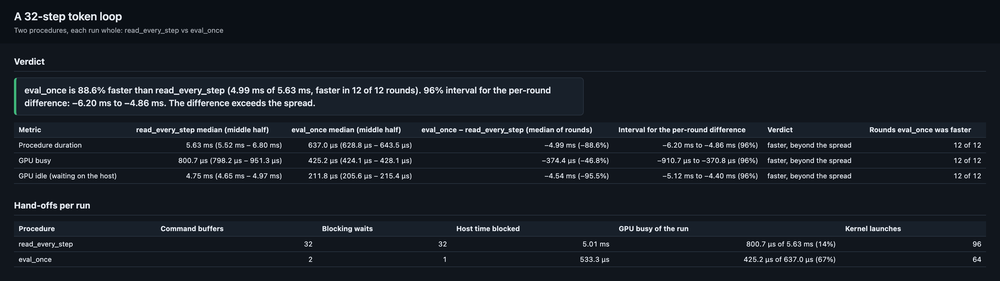

# mlx-performance-profiler 0.4.0: measure whole loops, and see why a kernel is slow



*Drawn by the profiler itself: the procedure comparison page from this release's documented example, a 32-step loop (a 1 × 256 state through a 256 × 256 matrix and tanh each step) written two ways. Reading a value back after every step costs 32 blocking waits and leaves the GPU idle 84% of the run. One run on one Mac.*

Until now the profiler could only compare two single MLX graphs. Real inference code is rarely one graph: a token loop evaluates once per token, a sampler reads values back, a pipeline runs host code between evaluations. 0.4.0 measures that code whole. It tells you which of two versions is faster, how much of each run the GPU spent waiting on the host, and how many times host and GPU handed work back and forth. It also records the shape of every kernel launch, so when a kernel is slower for the same work you can see whether it left GPU cores with nothing to do. In the example above, the loop that reads back every step takes 5.63 ms where the same loop evaluated once takes 0.64 ms. The GPU sat idle for 4.75 ms of it.

## Highlights

**Compare whole loops and pipelines, not just single graphs (#38).** Give `mlx_perf_compare_procedures_to_report` two procedures: a `run` callback timed from its start until all its GPU work completes, and an optional `prepare` that resets state, untimed, before every run. They run in the same 12 interleaved rounds, with the order flipped every round, and get the same verdict as graph comparisons. The verdict covers three numbers: the run's duration, **GPU busy** (time at least one of the run's command buffers was on the GPU, from Metal's own timestamps) and **GPU idle** (the rest of the run: the GPU waiting on the host). When the faster version saves mostly idle time, it did not make the GPU work less; it kept the GPU fed.

**Count the hand-offs that cost you (#38).** The profiler counts each run's command buffers (MLX's submissions to the GPU) and its **blocking waits**: evaluations and synchronizes that stop the host until the GPU finishes, so neither side can run ahead. In the 32-step loop above, the number of waits is the whole story: 32 against 1. It does this with observation-only hooks on MLX's Metal command buffers and events, which call the original first and never change what MLX computes.

**See why a kernel is slower for the same work (#35).** Every kernel launch MLX encodes is now recorded with its Metal function, grid, threadgroup shape and the share of GPU cores it can give work to. A threadgroup runs on one core, so a launch with fewer threadgroups than the GPU has cores leaves cores idle, and the report flags it ⚠. In the acceptance test, one custom kernel doing the same work launched as 4 threadgroups and as 512: *many_groups is 96.6% faster than four_groups (8.66 ms of 8.96 ms, faster in 12 of 12 rounds)*, and the comparison page shows why: 4 threadgroups can keep 4 of 16 cores busy. On a Qwen3.5-0.8B decode step, 684 of the eager version's 943 launches cannot fill the 16-core GPU.

**Documentation written for people and coding agents (#36, #37).** `docs/` answers one question per page with complete examples: getting started, profiling, comparing implementations, comparing procedures, the JSON formats with their JSON Schemas, troubleshooting by exact error text, and a C API reference. Every example is a file the test suite builds and runs, and tests fail when a page drifts from the code. The docs are indexed on [Context7](https://context7.com/aosama/mlx-performance-profiler) with rules for agents, and re-indexed whenever they change.

## Get started

**From source with CMake FetchContent:**

```cmake
include(FetchContent)
FetchContent_Declare(mlx_perf
  GIT_REPOSITORY https://github.com/aosama/mlx-performance-profiler.git
  GIT_TAG v0.4.0)
FetchContent_MakeAvailable(mlx_perf)   # with -DMLX_PREFIX=... on your command line
target_link_libraries(my_test PRIVATE mlx_perf::mlx_perf)
```

**As an installed package:**

```sh
git clone --branch v0.4.0 https://github.com/aosama/mlx-performance-profiler.git
cd mlx-performance-profiler
cmake -S . -B build -DMLX_PREFIX=/path/to/mlx/prefix \
      -DMLX_PERF_BUILD_TOOLS=OFF -DMLX_PERF_BUILD_TESTS=OFF
cmake --build build
cmake --install build --prefix /path/to/install
```

```cmake
# In the consumer: cmake -DMLX_PREFIX=... -DCMAKE_PREFIX_PATH=/path/to/install
find_package(mlx_perf 0.4 REQUIRED)
target_link_libraries(my_test PRIVATE mlx_perf::mlx_perf)
```

`MLX_PREFIX` points at a prebuilt MLX of a tested release (0.32.4 or 0.32.5). An installed package accepts only the MLX release it was built against.

**Pinning the source archive:**

```sh
curl -LO https://github.com/aosama/mlx-performance-profiler/releases/download/v0.4.0/mlx-performance-profiler-0.4.0.tar.gz
curl -LO https://github.com/aosama/mlx-performance-profiler/releases/download/v0.4.0/mlx-performance-profiler-0.4.0.tar.gz.sha256
shasum -a 256 -c mlx-performance-profiler-0.4.0.tar.gz.sha256
```

The archive (2.3 MB) has SHA-256 `7dfa2a65d80454cf8b3bd393f01b07449d5c86b547267730ae27d1c8e818874c`.

**Compare two procedures**, the program in the picture above. It is in the repository at this tag, with a CMake project that builds it:

```sh
git clone --branch v0.4.0 https://github.com/aosama/mlx-performance-profiler.git mlx-performance-profiler-examples
cd mlx-performance-profiler-examples/docs/examples
cmake -S . -B build -DMLX_PREFIX=/path/to/mlx/prefix
cmake --build build
./build/compare_two_procedures build
open build/token_loop.html
```

The heart of it is two structs and one call:

```c
const mlx_perf_procedure baseline  = {"read_every_step", prepare_loop, run_loop, &reading_loop};
const mlx_perf_procedure candidate = {"eval_once",       prepare_loop, run_loop, &batched_loop};
mlx_perf_procedure_comparison_summary summary;
mlx_perf_compare_procedures_to_report(&baseline, &candidate, "A 32-step token loop",
                                      output_directory, "token_loop", &summary);
```

It writes `token_loop.html` (the verdict, the hand-offs per run, the kernel launches by Metal function) and `token_loop.json` (every round of both procedures).

Full documentation at this tag: [Comparing procedures](https://github.com/aosama/mlx-performance-profiler/blob/v0.4.0/docs/comparing-procedures.md), [Reading the report](https://github.com/aosama/mlx-performance-profiler/blob/v0.4.0/docs/reading-the-report.md), [all guides](https://github.com/aosama/mlx-performance-profiler/blob/v0.4.0/docs/README.md).

## What's new

**Procedure comparisons (#38, #41).** New C API: `mlx_perf_compare_procedures_to_report`, with `mlx_perf_procedure`, `mlx_perf_procedure_step_fn`, `mlx_perf_procedure_summary` and `mlx_perf_procedure_comparison_summary`. Each procedure runs 14 times: a warm-up, one observed run that records its kernel launches, and one run in each of the 12 rounds. It writes `<base>.html` and `<base>.json`, a new record kind, `"kind": "procedure_comparison"` (schema version 1), described in [the measurement file](https://github.com/aosama/mlx-performance-profiler/blob/v0.4.0/docs/measurement-file.md#the-procedure-comparison-record-kind-procedure_comparison) with its own [JSON Schema](https://github.com/aosama/mlx-performance-profiler/blob/v0.4.0/docs/schema/procedure-comparison-record.schema.json). A callback that returns non-zero stops the comparison with `procedure <name>: run returned <n>`, and nothing is written. Guide: [Comparing procedures](https://github.com/aosama/mlx-performance-profiler/blob/v0.4.0/docs/comparing-procedures.md).

**Kernel launch shapes and GPU coverage (#35, #40).** Every node's launches are recorded in the serial pass and appear everywhere a reader looks. In the measurement file they are `nodes[].kernel_dispatches[]` and `job.gpu` (the GPU's name and core count); the fields are new, and `schema_version` stays 1. The task table gains a **Launches** column. The graph view gains a ⚠ line on nodes and stages, a **GPU coverage** colour mode, launches in the hover card, and search by Metal function. The comparison page gains a **Kernel launches side by side** table. New C API: `mlx_perf_install_launch_recorder()`, which you call before your first MLX evaluation so every kernel compiled afterwards is named. Kernels compiled before it are recorded unnamed, with their shapes. The coverage figure claims only what is exact: threadgroups against the core count, which comes from the IO registry. Full coverage rules out this one cause of slowness, and the docs say so.

**Documentation and Context7 (#36, #37).** `docs/` with ten guides, a C API reference, three JSON Schemas and four C example programs plus a Python reader, all built, run or validated by the test suite. `context7.json` publishes them to Context7 with twelve rules for agents, and a workflow asks Context7 to re-index when the docs change on `main`.

**MLX 0.32.4 verified (#39).** 0.32.4 had been declared but never tested. The 0.3.0 library code passed its full suite on MLX 0.32.4, and a Qwen3.5 decode step profiled the same 1,144 nodes in 25 stages there.

## Upgrading from 0.3.0

1. Move version pins to 0.4: `find_package(mlx_perf 0.4 REQUIRED)` or `GIT_TAG v0.4.0`. Before 1.0 the installed package accepts only its own minor version.
2. Optionally, call `mlx_perf_install_launch_recorder()` at the start of your program, before the first MLX evaluation, so every kernel launch in your reports is named.
3. If you read the measurement file with a strict schema, allow the new fields: `nodes[].kernel_dispatches` and `job.gpu`.

Nothing else changes: every 0.3.0 C function and struct keeps its signature and layout, the measurement file and comparison record stay `schema_version` 1 with fields only added, and every number the profiler measured before is measured the same way. The launch hooks cost nothing measurable: a Qwen3.5 eager decode step's job duration was 3.13 ms against 3.14 ms in 0.3.0 (#40).

## Compatibility

- **MLX:** declared tested releases 0.32.4 and 0.32.5, Metal backend, macOS on Apple silicon. This release's own test run used MLX 0.32.5. MLX 0.32.4 was verified on the 0.3.0 code (#39); the code new in 0.4.0 (#35, #38) has run on 0.32.5 only.
- **C API:** added `mlx_perf_compare_procedures_to_report` and `mlx_perf_install_launch_recorder`; added structs `mlx_perf_procedure`, `mlx_perf_procedure_summary` and `mlx_perf_procedure_comparison_summary`, and the callback type `mlx_perf_procedure_step_fn`. Nothing removed or changed.
- **File formats:** measurement file and comparison record `schema_version` 1, with fields added; new procedure comparison record, `schema_version` 1.
- **Version promise:** under [`VERSIONING.md`](https://github.com/aosama/mlx-performance-profiler/blob/v0.4.0/VERSIONING.md), new C API functions make a minor release before 1.0.

## How this release was verified

- **Tests:** 75 CTest tests, all passing on MLX 0.32.5 from this release's branch: unit, component, integration on the Metal GPU, acceptance, packaging and documentation. 0.3.0 had 54. New ones include two acceptance tests:
  - `launch_occupancy_acceptance_test`: the 4-against-512 threadgroup comparison above;
  - `procedure_handoffs_acceptance_test`: a 32-step loop that reads back every step must lose to the same loop evaluated once, mostly through GPU idle time, with at least 32 blocking waits against at most 2.

  The Node suite for the graph view has 44 tests.
- **Docs:** `docs_examples_journey` builds the four documented C programs as a reader would, runs them, and validates every JSON file they write against the published schemas. Other tests check that each page's copy of an example matches the file, that every quoted error message exists in the source, and that every C declaration is in the reference.
- **Real model:** on Qwen3.5-0.8B (4-bit), the launch recorder found the 684 of 943 eager launches that cannot fill the GPU. Compiled stayed 6.2% faster than eager in 12 of 12 rounds, the same verdict as before the hooks (#40).
- **Reviews:** a code review ran on each pull request before merge, and its findings were fixed before release. In the procedure comparison (#41), the review found:
  - each run's end was read after the profiler's own per-buffer bookkeeping, which would have charged procedures with many command buffers a little extra; it is now read from the GPU's own end times;
  - a Mac where the hooks cannot be installed would have reported every run as 100% GPU idle; it now refuses with a clear error;
  - the launch table's note would have said "the GPU's 0 cores" on a GPU whose core count is unknown.

  In the launch recorder (#40), it caught a README overstatement, corrected to "about 30× as long".

## Known limitations and what's next

- macOS and Metal only.
- A procedure comparison sees each run whole, not node by node. To find the slow operation inside one step, profile that step as a graph job.
- Blocking waits are counted on the thread that calls the procedure; MLX evaluates there, but work a procedure hands to its own threads is not observed.
- GPU coverage is one bound: a launch that covers every core can still be limited by per-core thread or memory limits, which Apple does not document and the profiler does not estimate.
- The Rust example does not yet mirror the procedure comparison structs.
- No continuous integration yet: the suite runs on a maintainer's machine before each tag.

Open roadmap:

- #20 Continuous integration: build and test against every tested MLX release
- #15 Support Linux with MLX's CUDA backend
- #14 Research: how should callers in C, C++, Swift, Python, Rust and Node use the profiler?

## For agents

```yaml
release: 0.4.0
tag: v0.4.0
previous_release: 0.3.0
repository: aosama/mlx-performance-profiler
source_archive:
  url: https://github.com/aosama/mlx-performance-profiler/releases/download/v0.4.0/mlx-performance-profiler-0.4.0.tar.gz
  sha256: 7dfa2a65d80454cf8b3bd393f01b07449d5c86b547267730ae27d1c8e818874c
cmake:
  find_package: "find_package(mlx_perf 0.4 REQUIRED)"
  target: mlx_perf::mlx_perf
  requires: MLX_PREFIX pointing at a tested MLX release
tested_mlx_releases: ["0.32.4", "0.32.5"]   # declared
verified_on_mlx: ["0.32.5"]                 # this release's run; 0.32.4 verified on the 0.3.0 code (#39)
platform: macOS, Apple silicon, Metal
c_api:
  header: include/mlx_perf/mlx_perf_c_api.h
  added: [mlx_perf_compare_procedures_to_report, mlx_perf_install_launch_recorder]
  structs_added: [mlx_perf_procedure, mlx_perf_procedure_summary, mlx_perf_procedure_comparison_summary]
  types_added: [mlx_perf_procedure_step_fn]
  removed: []
file_formats:
  measurement_file_schema_version: 1          # fields added: nodes[].kernel_dispatches, job.gpu
  comparison_record_schema_version: 1
  procedure_comparison_record_schema_version: 1   # new, "kind": "procedure_comparison"
shipped_issues: [35, 38]
opening_visual: https://raw.githubusercontent.com/aosama/mlx-performance-profiler/v0.4.0/release-notes/media/v0.4.0-procedures.png
docs:
  readme: https://github.com/aosama/mlx-performance-profiler/blob/v0.4.0/README.md
  guides: https://github.com/aosama/mlx-performance-profiler/blob/v0.4.0/docs/README.md
  changelog: https://github.com/aosama/mlx-performance-profiler/blob/v0.4.0/CHANGELOG.md
  context7: https://context7.com/aosama/mlx-performance-profiler
```

**Full changelog:** https://github.com/aosama/mlx-performance-profiler/compare/v0.3.0...v0.4.0
