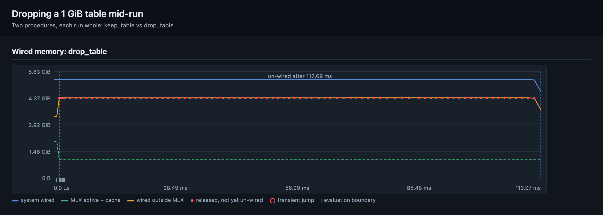

# mlx-performance-profiler 0.5.0: see how much room the GPU has under macOS's wire limit



*Drawn by the profiler itself: the wired memory lane of a 0.5.0 procedure comparison in which a procedure drops a 1 GiB table part-way through its run and keeps evaluating. MLX's holding (green) falls at once, but the system's wired total (blue) follows only 112.7 ms later, so "wired outside MLX" (orange) counts MLX's released gigabyte as someone else's in 91 samples (red dots). One run on one Mac.*

On Apple silicon the memory the GPU works on is wired, and macOS keeps wired memory under a system-wide line. An inference engine that decides how much to keep in memory has to know how close it is to that line. The usual estimate, "wired outside MLX", turns out to be wrong in both directions. 0.5.0 shows the wired total, MLX's own holding and the limit side by side in every report, marks the moments the estimate misleads, and gives your code the same reading and a probe that measures the delay on your Mac. It also fixes procedure comparisons for engines that run MLX on their own thread, which 0.4.0 reported as doing no GPU work.

## Highlights

**See how close your job runs to the wire limit (#45).** Every report now has a **Wired memory** lane:
- it shows the system's wired total, MLX's active memory plus cache, the part wired outside MLX, and the limit (`vm.global_user_wire_limit`), with the room left under it;
- a procedure comparison has one lane per procedure, sampled after every blocking wait for the GPU on any thread, every millisecond in between, and after the run until macOS has caught up;
- sampling happens only in the run that is never judged, so the verdict pays nothing for it;
- the JSON carries every sample and the summary.

**Know when "wired outside MLX" misleads, and by how much (#45).** Measured with the new probe on one Apple silicon Mac:
- memory MLX releases right after the GPU used it stays wired about **0.2 s** longer (180 to 240 ms across runs), so for that long the estimate counts MLX's released memory as someone else's;
- memory MLX still holds is un-wired after about **1.2 s** without GPU use, so the estimate also reads too low while memory sits idle, though that memory is wired again on its next use;
- the lane marks each release, how long macOS took to follow it, and every sample the delay inflated. In the picture above, a 1 GiB release inflated 91 samples by up to 1 GiB.

**Read it from your own code, and measure your Mac (#45).** `mlx_perf_read_wired_memory` takes one reading, cheap enough to call after every evaluation. `mlx_perf_measure_wire_release_lag` runs the probe: it waits for the wired total to settle, allocates and releases memory, times the un-wire, and prints progress with an ETA.

**Engines with an owner thread for MLX are measured correctly (#44).** A procedure whose `run` hands its MLX work to a worker thread now shows its command buffers, blocking waits, GPU busy time and kernel launches. 0.4.0 showed none of them and reported the whole run as GPU idle.

## Get started

**From source with CMake FetchContent:**

```cmake
include(FetchContent)
FetchContent_Declare(mlx_perf
  GIT_REPOSITORY https://github.com/aosama/mlx-performance-profiler.git
  GIT_TAG v0.5.0)
FetchContent_MakeAvailable(mlx_perf)   # with -DMLX_PREFIX=... on your command line
target_link_libraries(my_test PRIVATE mlx_perf::mlx_perf)
```

**As an installed package:**

```sh
git clone --branch v0.5.0 https://github.com/aosama/mlx-performance-profiler.git
cd mlx-performance-profiler
cmake -S . -B build -DMLX_PREFIX=/path/to/mlx/prefix \
      -DMLX_PERF_BUILD_TOOLS=OFF -DMLX_PERF_BUILD_TESTS=OFF
cmake --build build
cmake --install build --prefix /path/to/install
```

```cmake
# In the consumer: cmake -DMLX_PREFIX=... -DCMAKE_PREFIX_PATH=/path/to/install
find_package(mlx_perf 0.5 REQUIRED)
target_link_libraries(my_test PRIVATE mlx_perf::mlx_perf)
```

`MLX_PREFIX` points at a prebuilt MLX of a tested release (0.32.4 or 0.32.5). An installed package accepts only the MLX release it was built against.

**Pinning the source archive:**

```sh
curl -LO https://github.com/aosama/mlx-performance-profiler/releases/download/v0.5.0/mlx-performance-profiler-0.5.0.tar.gz
curl -LO https://github.com/aosama/mlx-performance-profiler/releases/download/v0.5.0/mlx-performance-profiler-0.5.0.tar.gz.sha256
shasum -a 256 -c mlx-performance-profiler-0.5.0.tar.gz.sha256
```

**Read the wired memory and measure the release lag.** The documented example is in the repository at this tag:

```sh
git clone --branch v0.5.0 https://github.com/aosama/mlx-performance-profiler.git mlx-performance-profiler-examples
cd mlx-performance-profiler-examples/docs/examples
cmake -S . -B build -DMLX_PREFIX=/path/to/mlx/prefix
cmake --build build
./build/measure_wired_memory
```

The heart of it is one reading and one probe call:

```c
mlx_perf_wired_memory reading;
mlx_perf_read_wired_memory(&reading);   /* wired total, limit, MLX's holding, outside MLX, room left */

mlx_perf_wire_release_lag release_lag;
mlx_perf_measure_wire_release_lag(256ull << 20, 3, &release_lag);   /* 3 repetitions of 256 MiB */
```

On the Mac the example was written on, it printed:

```text
before         wired     3041 MiB, MLX      0 MiB, outside MLX     3041 MiB, room under the limit    35789 MiB
while held     wired     3608 MiB, MLX    512 MiB, outside MLX     3096 MiB, room under the limit    35222 MiB
just released  wired     3608 MiB, MLX      0 MiB, outside MLX     3608 MiB, room under the limit    35222 MiB
released memory un-wired after 176.1 ms (median of 3, largest 176.3 ms); limit 38830 MiB
```

Full documentation at this tag: [Wired memory](https://github.com/aosama/mlx-performance-profiler/blob/v0.5.0/docs/wired-memory.md), [Comparing procedures](https://github.com/aosama/mlx-performance-profiler/blob/v0.5.0/docs/comparing-procedures.md), [all guides](https://github.com/aosama/mlx-performance-profiler/blob/v0.5.0/docs/README.md).

## What's new

**Wired memory beside MLX's own (#45, #48).**
- **Reports:** a lane sampled once as the serial pass begins, then after each node's evaluation, outside the timed windows. That pass keeps every intermediate alive, so the lane shows how close the job runs to the limit.
- **Procedure comparisons:** one lane per procedure, sampled over its observed run through a new evaluation-boundary seam in the submission recorder. After the run, sampling continues until macOS has un-wired what the run released, for at most 3 s.
- **JSON:** `job.wired_memory` in the measurement file, and `baseline.wired_memory` and `candidate.wired_memory` in the procedure comparison record. The fields are additive under `schema_version` 1, with the JSON Schemas updated. Each record has the limit, the peaks, the lowest "outside MLX", the least room under the limit, whether the run crossed it, every release with its lag (`null` when macOS had not followed before sampling stopped), the inflated samples, and every sample.
- **C API:** `mlx_perf_read_wired_memory` and `mlx_perf_measure_wire_release_lag`, with the structs `mlx_perf_wired_memory` and `mlx_perf_wire_release_lag` (48 bytes each).
- **Docs:** a new guide, [Wired memory](https://github.com/aosama/mlx-performance-profiler/blob/v0.5.0/docs/wired-memory.md), with an example program the test suite builds and runs, plus troubleshooting entries for the new messages and for the two ways "outside MLX" moves.

**A finding about macOS behind it.** The profiler reads the wired total through `sysctl vm.page_wired_count`. macOS rate limits `host_statistics64` for ordinary processes to a few fresh answers a second and returns cached figures after that. Polled quickly, `host_statistics64` gave stale totals, and a first measurement of the release lag came out near a second: that was the rate limiter's window, not the delay. If your engine polls `host_statistics64`, its readings may be stale in the same way.

**Byte sizes of 1 GiB and over read in GiB** on every page: "37.92 GiB", not "38830.6 MiB".

## Fixes

**Procedures that evaluate on another thread (#44, #47).**
- **Before:** in 0.4.0, a procedure whose `run` sent its MLX work to a worker thread and waited, as an engine with an owner thread for MLX does, was reported with zero command buffers, zero GPU busy time, no kernel launches, and the whole run as GPU idle. The duration verdict was right; the rest was not.
- **Now:** every command buffer, blocking wait and kernel launch anywhere in the process while `run` runs is counted as the procedure's. Procedures run one at a time, so that work is theirs.
- **Unchanged:** graph jobs' serial pass still records only the thread that evaluates, so a node's launches stay its own.
- **For engine authors:** MLX 0.32 streams belong to the thread that made them, so an owner thread must evaluate on its own stream.

## Upgrading from 0.4.0

1. Move version pins to 0.5: `find_package(mlx_perf 0.5 REQUIRED)` or `GIT_TAG v0.5.0`. Before 1.0 the installed package accepts only its own minor version.
2. If you read the JSON with a strict schema, allow the new fields: `job.wired_memory`, and `baseline.wired_memory` and `candidate.wired_memory` in the procedure comparison record.
3. If you compare procedures that run MLX on a worker thread, expect real GPU busy, idle and hand-off figures where 0.4.0 showed zeros. Use MLX for nothing else while a comparison runs: everything the process submits meanwhile is counted.

Nothing else changes. Every 0.4.0 C function and struct keeps its signature and layout, all three JSON formats stay `schema_version` 1 with fields only added, and every timing is measured as before. The wired samples are taken outside every timed window.

## Compatibility

- **MLX:** declared tested releases 0.32.4 and 0.32.5, on the Metal backend, macOS on Apple silicon. This release's own test run used MLX 0.32.5. MLX 0.32.4 was last verified on the 0.3.0 code, so the code new since then has run on 0.32.5 only.
- **C API:** added `mlx_perf_read_wired_memory` and `mlx_perf_measure_wire_release_lag`, and the structs `mlx_perf_wired_memory` and `mlx_perf_wire_release_lag`. Nothing removed or changed.
- **File formats:** the measurement file, the comparison record and the procedure comparison record are all `schema_version` 1, with fields added.
- **Report size:** a graph report's embedded measurement document grows by about 370 bytes per node for its wired samples, about 0.4 MB for a 1,144-node Qwen3.5 decode step. A procedure's observed run adds about one sample per millisecond.
- **Version promise:** under [`VERSIONING.md`](https://github.com/aosama/mlx-performance-profiler/blob/v0.5.0/VERSIONING.md), new C API functions make a minor release before 1.0.

## How this release was verified

- **Tests:** 85 CTest tests, all passing on MLX 0.32.5 from this release's branch: unit, component, integration on the Metal GPU and the kernel, acceptance, packaging and documentation. 0.4.0 had 75. New ones include:
  - `wired_memory_acceptance_test`: a procedure drops a 1 GiB table mid-run, and the comparison must show the release, its resolved lag and the inflated samples, on the page and in the record;
  - `wired_memory_analysis_test`: releases, lags, inflation, the low direction, transient jumps and thresholds, on synthetic samples;
  - `recording_slots_test`, plus whole-process cases in both recorders' tests, `procedure_measurement_test` and the C API test: an owner-thread procedure (#44);
  - `wire_release_probe_test` and `mlx_perf_c_api_wired_memory_test`: the probe on the real GPU.
- **Docs:** `docs_examples_journey` builds the five documented C programs as a reader would and runs them, including the new `measure_wired_memory`. It validates every JSON file they write against the published schemas.
- **Measurements behind the claims:** with live `sysctl` reads on one Mac, a 1 GiB array raised the wired total by about 1 GiB. Released right after use, it was un-wired after 236 to 238 ms in three trials, and after 176 ms in the example's run. Held but idle, it was un-wired after 1,198 to 1,233 ms, then wired again on its next use.
- **Reviews:** a code review ran on each pull request, and a self-review of everything since 0.4.0 ran before this release (#49). Before release they found and fixed:
  - a second `start()` on the sampler would have terminated the process;
  - release labels on the lane overprinted when several releases were close together;
  - the release threshold was written into the page text by hand instead of from its constant;
  - wording in the report notes named the measuring machine.

## Known limitations and what's next

- macOS and Metal only.
- "Wired outside MLX" cannot tell other programs' wiring from MLX's own idle memory being un-wired: both lower it. The lane reports the lowest value, not its cause.
- A release lag is resolved to the sampling interval (1 ms in procedure runs), and is `null` when macOS takes longer than the profiler waited.
- In a graph report, the wired lane comes from the serial pass, which keeps every intermediate alive. It shows how close a job runs to the limit, not the releases an engine makes.
- The Rust example does not yet mirror the procedure or wired memory structs.
- No continuous integration yet: the suite runs on a maintainer's machine before each tag.

Open roadmap:

- #46 Compare procedures on memory too: peaks, what a run leaves behind, and whether it crossed the wire line
- #20 Continuous integration: build and test against every tested MLX release
- #15 Support Linux with MLX's CUDA backend
- #14 Research: how should callers in C, C++, Swift, Python, Rust and Node use the profiler?

## For agents

```yaml
release: 0.5.0
tag: v0.5.0
previous_release: 0.4.0
repository: aosama/mlx-performance-profiler
source_archive:
  url: https://github.com/aosama/mlx-performance-profiler/releases/download/v0.5.0/mlx-performance-profiler-0.5.0.tar.gz
  sha256_file: https://github.com/aosama/mlx-performance-profiler/releases/download/v0.5.0/mlx-performance-profiler-0.5.0.tar.gz.sha256
cmake:
  find_package: "find_package(mlx_perf 0.5 REQUIRED)"
  target: mlx_perf::mlx_perf
  requires: MLX_PREFIX pointing at a tested MLX release
tested_mlx_releases: ["0.32.4", "0.32.5"]   # declared
verified_on_mlx: ["0.32.5"]                 # this release's run; 0.32.4 last verified on the 0.3.0 code (#39)
platform: macOS, Apple silicon, Metal
c_api:
  header: include/mlx_perf/mlx_perf_c_api.h
  added: [mlx_perf_read_wired_memory, mlx_perf_measure_wire_release_lag]
  structs_added: [mlx_perf_wired_memory, mlx_perf_wire_release_lag]
  removed: []
file_formats:
  measurement_file_schema_version: 1          # field added: job.wired_memory
  comparison_record_schema_version: 1
  procedure_comparison_record_schema_version: 1   # fields added: baseline.wired_memory, candidate.wired_memory
behaviour_changes:
  - "procedure comparisons count GPU work on every thread while run() runs (#44)"
wired_memory_source: "sysctl vm.page_wired_count (host_statistics64 is rate limited)"
shipped_issues: [44, 45]
opening_visual: https://raw.githubusercontent.com/aosama/mlx-performance-profiler/v0.5.0/release-notes/media/v0.5.0-wired-memory.png
docs:
  readme: https://github.com/aosama/mlx-performance-profiler/blob/v0.5.0/README.md
  guides: https://github.com/aosama/mlx-performance-profiler/blob/v0.5.0/docs/README.md
  wired_memory: https://github.com/aosama/mlx-performance-profiler/blob/v0.5.0/docs/wired-memory.md
  changelog: https://github.com/aosama/mlx-performance-profiler/blob/v0.5.0/CHANGELOG.md
  context7: https://context7.com/aosama/mlx-performance-profiler
```

**Full changelog:** https://github.com/aosama/mlx-performance-profiler/compare/v0.4.0...v0.5.0
