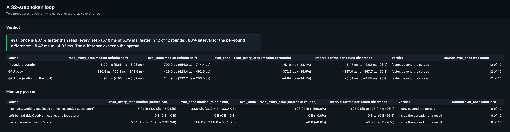

# mlx-performance-profiler 0.6.0: judge memory like time, on the same rounds



*Drawn by the profiler itself: the verdict and the new "Memory per run" table of a 0.6.0 procedure comparison. The documented example is a 32-step loop (a 1 × 256 state through a 256 × 256 matrix and tanh each step) that reads a value back after every step, against the same loop evaluated once. Evaluating once is far faster, and it keeps every step's intermediate alive until the end, so its peak working set is larger. One run on one Mac.*

Many engine changes are memory decisions first: what to keep, when to give it back, how large a working set a step builds. Until now a comparison judged only time, and memory had to be read by hand around each run, losing the verdict and the spread. 0.6.0 judges memory on the same interleaved rounds as time, with the same interval and verdict. A change that trades one for the other shows both sides on one page. When a round crossed macOS's wire limit or made the system compress memory, the page says so beside the timing verdict, because such a round is slow for a reason outside the code.

## Highlights

**Memory, judged on the same rounds as time (#46).** Both comparisons judge three memory figures:
- **Peak MLX working set:** MLX's peak active memory during a run, less what was active as it began. MLX's counters are process-wide, so this keeps the other side's memory out of the figure.
- **What a run left behind:** MLX's active memory plus cache at its end, less at its start. A cache that is never trimmed shows here.
- **The system's wired total as the run ended.**

Each figure is read just before and just after the run, never during it, so the time being judged pays nothing for it. The verdict reads "less" or "more", with the same 96% interval and 12 rounds as time. In the picture, evaluating once is 88.1% faster and its working set is 6.6 times larger, both beyond the spread in 12 of 12 rounds.

**A named cause for an unexplained slow round (#46).** Past `vm.global_user_wire_limit`, macOS stops keeping part of the GPU's memory wired, compresses it and may swap. Speed then falls although nothing in the code changed. The profiler reads the kernel's own counters around every round, live through sysctl:
- the wire requests the kernel refused over the limit (`vm.add_wire_count_over_global_limit`);
- the bytes it compressed (`vm.compressor_input_bytes`);
- the swap in use.

A note under the timing verdict counts the rounds in which either side crossed the limit or saw the system compress memory. A timing verdict built on such rounds is about the machine, not the change.

## Get started

**From source with CMake FetchContent:**

```cmake
include(FetchContent)
FetchContent_Declare(mlx_perf
  GIT_REPOSITORY https://github.com/aosama/mlx-performance-profiler.git
  GIT_TAG v0.6.0)
FetchContent_MakeAvailable(mlx_perf)   # with -DMLX_PREFIX=... on your command line
target_link_libraries(my_test PRIVATE mlx_perf::mlx_perf)
```

**As an installed package:**

```sh
git clone --branch v0.6.0 https://github.com/aosama/mlx-performance-profiler.git
cd mlx-performance-profiler
cmake -S . -B build -DMLX_PREFIX=/path/to/mlx/prefix \
      -DMLX_PERF_BUILD_TOOLS=OFF -DMLX_PERF_BUILD_TESTS=OFF
cmake --build build
cmake --install build --prefix /path/to/install
```

```cmake
# In the consumer: cmake -DMLX_PREFIX=... -DCMAKE_PREFIX_PATH=/path/to/install
find_package(mlx_perf 0.6 REQUIRED)
target_link_libraries(my_test PRIVATE mlx_perf::mlx_perf)
```

`MLX_PREFIX` points at a prebuilt MLX of a tested release (0.32.4 or 0.32.5). An installed package accepts only the MLX release it was built against.

**Pinning the source archive:**

```sh
curl -LO https://github.com/aosama/mlx-performance-profiler/releases/download/v0.6.0/mlx-performance-profiler-0.6.0.tar.gz
curl -LO https://github.com/aosama/mlx-performance-profiler/releases/download/v0.6.0/mlx-performance-profiler-0.6.0.tar.gz.sha256
shasum -a 256 -c mlx-performance-profiler-0.6.0.tar.gz.sha256
```

The archive (2.5 MB) has SHA-256 `50245dd6ff7ed543f7a05706cc8ff6502396af458cf36c3d036dde7cfbe12fd2`.

**Run the comparison in the picture.** The documented example is in the repository at this tag:

```sh
git clone --branch v0.6.0 https://github.com/aosama/mlx-performance-profiler.git mlx-performance-profiler-examples
cd mlx-performance-profiler-examples/docs/examples
cmake -S . -B build -DMLX_PREFIX=/path/to/mlx/prefix
cmake --build build
./build/compare_two_procedures build
open build/token_loop.html
```

It printed, in the run the picture comes from:

```text
duration: candidate faster, median difference -5104.2 us (-88.1%)
GPU idle: 4933.6 us vs 244.9 us per run; blocking waits: 32 vs 1 per run
peak MLX working set: candidate uses more, 5.0 KiB vs 33.0 KiB; rounds over the wire limit: 0 vs 0
```

From C, the memory verdicts are in the summary you already pass:

```c
mlx_perf_procedure_comparison_summary summary;
mlx_perf_compare_procedures_to_report(&baseline, &candidate, "My step", "build", "step", &summary);
/* summary.peak_mlx_active_added, summary.mlx_held_change, summary.system_wired_at_end:
 * each an mlx_perf_memory_comparison, in bytes; and per side, the rounds that
 * crossed the wire limit or saw the system compress memory. */
```

Full documentation at this tag: [Memory, judged on the same rounds](https://github.com/aosama/mlx-performance-profiler/blob/v0.6.0/docs/comparing-procedures.md#memory-judged-on-the-same-rounds), [the JSON fields](https://github.com/aosama/mlx-performance-profiler/blob/v0.6.0/docs/measurement-file.md#a-runs-memory), [all guides](https://github.com/aosama/mlx-performance-profiler/blob/v0.6.0/docs/README.md).

## What's new

**Memory judged like time (#46, #53).**
- **Pages:** the procedure comparison page gains a **Memory per run** section, and the graph comparison's verdict gains a memory table. Both have a memory pressure note under the headline when any round crossed the wire limit or saw compression.
- **JSON:** every run in the procedure record gains `memory`, with its peak and working set, what it left behind, the wired total and limit at its end, refused wire requests, compressed bytes, the change in swap, and two flags. Each side gains `rounds_crossing_wire_limit` and `rounds_with_compression`. The metrics gain `peak_mlx_active_added_bytes`, `mlx_held_change_bytes` and `system_wired_at_end_bytes`, whose difference fields are named in bytes. The graph comparison record gains `memory` with the same figures and metrics. All additive under `schema_version` 1, with the JSON Schemas updated.
- **C API:** `mlx_perf_memory_comparison` (64 bytes). `mlx_perf_procedure_comparison_summary` gains `peak_mlx_active_added`, `mlx_held_change`, `system_wired_at_end` and four round counts.
- **Docs:** a memory section in both comparison guides, the procedure example printing the memory verdict, the formats, the reference, two troubleshooting entries and a Context7 rule.

**What it does not measure, and why.** Reading inside a judged run would add its cost to the time being judged, more for the side that evaluates more often. So:
- the peak of active plus cache and the peak system wired total are not judged; the end-of-run figures stand in, and the [wired memory lane](https://github.com/aosama/mlx-performance-profiler/blob/v0.6.0/docs/wired-memory.md) from 0.5.0 has both true peaks for the observed run;
- decompressions and swap-ins have no live counter (`vm_statistics64` comes through the rate-limited `host_statistics64`), so swap in use is reported instead.

**For maintainers: Context7 stays current with every release (#52).** The in-repository release skill now has a step that checks every new capability and changed behaviour is in the documentation Context7 indexes, then confirms after the merge that Context7 serves it.

## Upgrading from 0.5.0

1. Move version pins to 0.6: `find_package(mlx_perf 0.6 REQUIRED)` or `GIT_TAG v0.6.0`. Before 1.0 the installed package accepts only its own minor version.
2. **Rebuild code that allocates `mlx_perf_procedure_comparison_summary`:** it grows from 496 to 704 bytes. A caller compiled against 0.5.0's header and linked to 0.6.0 would pass a buffer too small for the summary.
3. If you read the JSON with a strict schema, allow the new fields listed above.

Nothing else changes. Every function keeps its signature. `mlx_perf_comparison_summary` (graph comparisons) is unchanged, so its Rust mirror stays valid; read its memory figures from the JSON. Every timing is measured as before: the memory reads sit outside every timed window.

## Compatibility

- **MLX:** declared tested releases 0.32.4 and 0.32.5, on the Metal backend, macOS on Apple silicon. This release's own test run used MLX 0.32.5. MLX 0.32.4 was last verified on the 0.3.0 code, so the code new since then has run on 0.32.5 only.
- **C API:** added `mlx_perf_memory_comparison`; `mlx_perf_procedure_comparison_summary` grew (fields appended). No function added, removed or changed.
- **File formats:** the measurement file, the comparison record and the procedure comparison record are all `schema_version` 1, with fields added.
- **Version promise:** under [`VERSIONING.md`](https://github.com/aosama/mlx-performance-profiler/blob/v0.6.0/VERSIONING.md), a changed C struct makes a minor release before 1.0.

## How this release was verified

- **Tests:** 90 CTest tests, all passing on MLX 0.32.5 from this release's branch with the GPU quiet: unit, component, integration on the Metal GPU and the kernel, acceptance, packaging and documentation. 0.5.0 had 85. New ones include:
  - `memory_comparison_acceptance_test`: a step that builds a 256 MiB scratch working set and keeps 32 MiB per run must be judged "more" on both its working set and what it leaves behind, beyond the spread, on the page and in the record;
  - `run_memory_meter_test` on the GPU: a run's own working set, and a negative change when a run frees what it found;
  - `system_memory_pressure_test` on the kernel;
  - memory cases in the record, page, verdict, live view and C API tests, including rounds that do not pair up.
- **Docs:** `docs_examples_journey` builds the five documented C programs, runs them and validates every JSON file against the updated schemas. The guide's example output is from a real run.
- **Reviews:** a code review ran before the pull request, and its findings were fixed before release:
  - the C summary's fields had different names from the JSON for the same figures;
  - a note pointed at wired memory lanes that a graph comparison page does not have;
  - three tests were missing.

  Writing the tests also found that the 0.5.0 probe tests failed while another program drove the GPU, since its wiring moves the same system-wide total. They now require the effect in at least one of three repetitions.

## Known limitations and what's next

- macOS and Metal only.
- Compression and swap are system-wide: another program's memory pressure counts in the note, which says so.
- The peak of active plus cache and the peak wired total are not judged per round (see above).
- In a graph comparison, a run's outputs are freed as it ends, so "left behind" there shows what the run added to MLX's cache.
- The Rust example does not yet mirror the procedure, wired memory or memory comparison structs.
- No continuous integration yet: the suite runs on a maintainer's machine before each tag.

Open roadmap:

- #20 Continuous integration: build and test against every tested MLX release
- #15 Support Linux with MLX's CUDA backend
- #14 Research: how should callers in C, C++, Swift, Python, Rust and Node use the profiler?

## For agents

```yaml
release: 0.6.0
tag: v0.6.0
previous_release: 0.5.0
repository: aosama/mlx-performance-profiler
source_archive:
  url: https://github.com/aosama/mlx-performance-profiler/releases/download/v0.6.0/mlx-performance-profiler-0.6.0.tar.gz
  sha256: 50245dd6ff7ed543f7a05706cc8ff6502396af458cf36c3d036dde7cfbe12fd2
cmake:
  find_package: "find_package(mlx_perf 0.6 REQUIRED)"
  target: mlx_perf::mlx_perf
  requires: MLX_PREFIX pointing at a tested MLX release
tested_mlx_releases: ["0.32.4", "0.32.5"]   # declared
verified_on_mlx: ["0.32.5"]                 # this release's run; 0.32.4 last verified on the 0.3.0 code (#39)
platform: macOS, Apple silicon, Metal
c_api:
  header: include/mlx_perf/mlx_perf_c_api.h
  added: []
  structs_added: [mlx_perf_memory_comparison]
  structs_changed:
    - "mlx_perf_procedure_comparison_summary: 496 -> 704 bytes (fields appended: peak_mlx_active_added, mlx_held_change, system_wired_at_end, baseline/candidate_rounds_crossing_wire_limit, baseline/candidate_rounds_with_compression); rebuild callers"
  unchanged: [mlx_perf_comparison_summary]
  removed: []
file_formats:
  measurement_file_schema_version: 1
  comparison_record_schema_version: 1            # field added: memory
  procedure_comparison_record_schema_version: 1  # fields added: rounds[].memory, observed_run.memory, rounds_crossing_wire_limit, rounds_with_compression, metrics.*_bytes
memory_pressure_sources: ["vm.add_wire_count_over_global_limit", "vm.compressor_input_bytes", "vm.swapusage"]
shipped_issues: [46]
opening_visual: https://raw.githubusercontent.com/aosama/mlx-performance-profiler/v0.6.0/release-notes/media/v0.6.0-memory.png
docs:
  readme: https://github.com/aosama/mlx-performance-profiler/blob/v0.6.0/README.md
  guides: https://github.com/aosama/mlx-performance-profiler/blob/v0.6.0/docs/README.md
  memory_comparison: https://github.com/aosama/mlx-performance-profiler/blob/v0.6.0/docs/comparing-procedures.md#memory-judged-on-the-same-rounds
  changelog: https://github.com/aosama/mlx-performance-profiler/blob/v0.6.0/CHANGELOG.md
  context7: https://context7.com/aosama/mlx-performance-profiler
```

**Full changelog:** https://github.com/aosama/mlx-performance-profiler/compare/v0.5.0...v0.6.0
